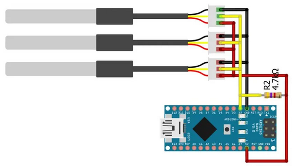

# AsyncTempSensor - Arduino-библиотека для DS18B20

Arduino-библиотека для **неблокирующей асинхронной работы** с температурными датчиками **DS18B20**.


## Возможности

- Работа с **одним или несколькими датчиками** на одном пине
- **Неблокирующий** режим через `millis()`
- Поддержка **callback-уведомлений** при готовности температуры
- Полностью **без использования `delay()`**
- Возможность включения **отладочного вывода**

## Пример использования

### Базовый пример:

```cpp
#include <AsyncTempSensor.h>

AsyncTempSensor tempSensor(2, [](int index, float temp) {
    Serial.print("🌡 Температура от датчика ");
    Serial.print(index);
    Serial.print(": ");
    Serial.println(temp);
});

void setup() {
    Serial.begin(9600);
	tempSensor.setDebugOutput(true); // Включить отладку
    tempSensor.begin();
}

void loop() {
    tempSensor.update(1000); // Обновление каждые 1 секунду
}
```

## Установка

1. Перейди в **Sketch -> Подключить библиотеку -> Управлять библиотеками**
2. Найди **AsyncTempSensor**
3. Установи библиотеку

Или вручную склонировать репозиторий в папку библиотек:

```bash
cd ~/Arduino/libraries
git clone https://github.com/MouseZver/AsyncTempSensor.git
```

## Функции

- `begin()` - инициализация и поиск датчиков
- `update(unsigned long interval)` - обновление температуры с заданным интервалом
- `setDebugOutput(true)` - включить отладочный вывод в Serial
- `callback` - вызывается при готовности температуры

## Подключение датчика

- **DATA датчика** -> **пин 2** (или любой другой, указанный при инициализации)
- **GND** -> **GND**
- **VCC** -> **5V**
- **Резистор 4.7 кОм** между **DATA и 5V**
